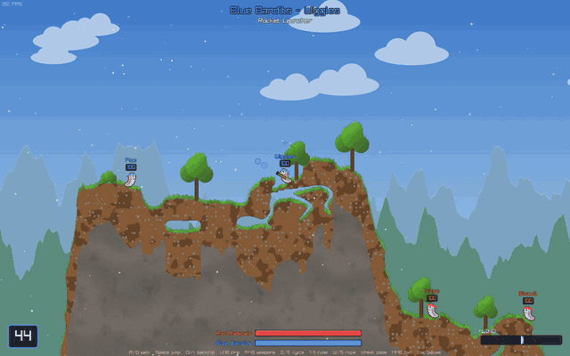

<h1 align="center">Worms</h1>

<p align="center"></p>

## Gameplay
Local hot-seat, turn-based artillery game. Two teams of four worms take turns on a procedurally generated island. Each turn has a 45 s timer, random wind, and a few seconds to retreat after attacking. Worms take fall damage, drown in the water (or lava), and leave a gravestone when they die. The last team standing wins.

### Destructible terrain
The terrain is a pixel mask with full Box2D physics:
* Explosions carve craters and scorch their edges.
* Collision outlines are rebuilt with marching squares, per 64 px chunk, only where the terrain changed.
* Pieces that end up floating free (a tree whose trunk got blown out, an overhang that lost its support) break off as rigid bodies. They tumble, hurt worms they land on, and get stamped back into the terrain once they settle.

### Biomes
Every match generates a new map in one of four themes: **Meadow**, **Dunes**, **Tundra** or **Volcano**. Each has its own materials, decorations (trees, cacti, pines and obsidian spires, all destructible), sky, parallax ridges, weather particles and liquid. Pick one in the main menu or leave it on random.

### Weapons
| Weapon | Use |
|---|---|
| Rocket Launcher | Hold to charge, explodes on impact, pushed by wind |
| Grenade | Hold to charge, bounces, explodes after its 1-5 s fuse |
| Cluster Bomb | Like the grenade, then splits into five bomblets (3 per match) |
| Airstrike | Click a target, five bombs drop from the sky (1 per match) |
| Ninja Rope | Click to fire and attach, swing with A/D, climb with W/S, Space to let go. Doesn't end the turn |
| Teleport | Click any open spot (2 per match) |
| Shotgun | Two hitscan shots per turn |

Each worm remembers its own weapon and grenade fuse between turns. Limited ammo is shared by the team.

## Stack
* **Standard** `CPP 20`
* **Build Tool:** `Premake`
* **Backend:** `Raylib`
* **Physics:** `Box2D` v3 (git submodule)
* **Logging:** `spdlog`

## Download

Pre-built binaries available on the [Releases page](https://github.com/Solessfir/Worms/releases):
* **Windows:** `Worms_Win64.zip`
* **Linux:** `Worms_Linux_x86_64.tar.gz`

## Getting the Source
Box2D is a submodule, so clone with `git clone --recursive https://github.com/Solessfir/Worms.git`, or run `git submodule update --init` in an existing clone.

## Build Prerequisites
- **Windows:** Visual Studio 2022 or higher
- **Linux:** `g++`, `make`, `wayland-scanner`, plus GL + Wayland dev libraries (e.g. `libgl1-mesa-dev libwayland-dev wayland-protocols libxkbcommon-dev`)

## Building on Windows
1. Run `Setup.bat`
2. Open `Worms.sln`
3. Build

`Setup.bat` generates VS2022 projects. With only VS2026 installed, generate them with `vendor\Premake\Windows\premake5.exe --file=premake.lua vs2026` instead, or build with `msbuild Worms.sln /p:Configuration=Release /p:Platform=x64 /p:PlatformToolset=v145`.

## Building on Linux
1. Run `./Setup.sh`
2. Debug build: `make config=debug -j$(nproc)`
    * Release: `make -j$(nproc)`
3. Run: `./bin/{Debug/Release}-linux-x86_64/Worms/Worms`

## Controls
* Mouse - aim
* LMB - fire (hold and release to charge throwing weapons)
* RMB - weapon panel, `Q`/`E` - previous/next weapon
* `1`-`5` - grenade fuse
* `A`/`D` or arrows - walk, `Space` - jump, `Ctrl` - backflip
* `W`/`S` - climb the rope
* Mouse wheel - zoom, MMB drag - pan the camera
* `Esc` - pause menu (resume, back to main menu, quit)

## Audio:
* Music: https://suno.com/
* Sound:
    * https://pixabay.com/sound-effects/
    * https://freesound.org/browse/

## Notable Reference
* Tsoding Music Visualizer based on Raylib:
    * https://www.youtube.com/playlist?list=PLpM-Dvs8t0Vak1rrE2NJn8XYEJ5M7-BqT
    * https://github.com/tsoding/musializer

## Build Warnings on Windows

```
LNK4075: ignoring '/INCREMENTAL' due to '/FORCE' specification
LNK4088: image being generated due to /FORCE option; image may not run
```
Expected, the game runs fine.

`raylib` and the `Win32` API both have a function called `CloseWindow`. We pass `/FORCE:MULTIPLE` so the linker just picks raylib's instead of erroring out ([raylib#729](https://github.com/raysan5/raylib/issues/729)).

So these warnings are side effect of `/FORCE:MULTIPLE`

### Local raylib patch
`winmm.lib` also exports `PlaySound`, and with `/FORCE:MULTIPLE` the linker can silently pick the Win32 one, which plays nothing. The vendored raylib adds `PlaySfx` (in `raudio.c` and `raylib.h`), and the game calls that instead of `PlaySound`. Re-apply this patch when updating raylib.

## License
Licensed under the [MIT License](LICENSE).
